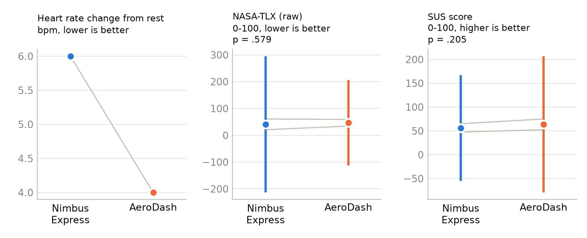

# Comparing Two Drone Delivery Dashboards: Nimbus Express vs. AeroDash

[Author 1 Name], [Author 2 Name], [Author 3 Name], [Author 4 Name]
*ENGR 321: Human Factors Engineering, [Department], [University]* · *Instructor: [Name]*

> **Generated file — do not edit `report/REPORT.md` by hand.** Edit `report/template.md`; the report rebuilds from the data on every push. Numbers in this version: 2 participants, 4 flights, built 2026-11-23 01:05 UTC from commit `04b5ca7`.

**_Abstract_—This study compared two drone delivery dashboards, Nimbus Express and AeroDash, to see how each one's design affects how quickly operators notice and act on alerts, how well they fly, and how stressed and loaded they feel. In a within-subject study, 2 participants flew a simulated delivery route once with each dashboard while three alerts appeared on the dashboard only: low battery, a wind warning, and a status check. No measure differed significantly between the dashboards at α = .05. [TO COMPLETE: one sentence on the main design recommendation.]**

**_Index Terms_—drone delivery, dashboard design, human factors, alert response, mental workload, heart rate, usability.**

## I. INTRODUCTION

Drone delivery operators watch a fleet dashboard while they fly or supervise, so an alert they miss or notice late can cost a delivery or a drone. We compared two dashboards that show the same information with different designs, Nimbus Express [1] and AeroDash [2]. [TO COMPLETE: one or two sentences on why this matters.]

### A. Research Questions

1. **RQ1 (behavioral):** How quickly and reliably do operators notice and act on alerts with each dashboard, and how well do they fly?
2. **RQ2 (physiological and subjective):** How much stress (heart-rate change from rest), workload (NASA-TLX), and usability (SUS) does each dashboard produce?
3. **RQ3 (groups):** [TO COMPLETE: confirm wording, e.g. Do ENGR 321 classmates, CS majors and esports club members, and other majors differ in performance?]

### B. Hypotheses

- **H1:** [TO COMPLETE, e.g. Alert reaction time will be shorter with (dashboard).]
- **H2:** [TO COMPLETE, e.g. Heart-rate change and NASA-TLX will be lower with (dashboard).]
- **H3:** [TO COMPLETE, e.g. SUS will be higher with (dashboard).]

## II. BACKGROUND AND RELATED WORK

[TO COMPLETE: 3 to 5 sources, about one paragraph each, cited by number in order of first use starting at [3].] Suggested topics: alert design and attention capture in supervisory displays; NASA-TLX [3] and SUS [4] as workload and usability measures; heart rate as a physiological stress indicator; the aesthetic-usability effect; what drone operators need to monitor.

## III. METHODOLOGY

### A. Study Design

Within-subject: every participant flew once with each dashboard. The independent variable is the dashboard (Nimbus Express or AeroDash). Dashboard order was counterbalanced (odd participant IDs used Nimbus first) and the alert order rotated every two participants (1-2-3, 2-3-1, 3-1-2), as assigned automatically by the simulator. Trial 2 used a mirrored copy of the Trial 1 route, so difficulty matched but participants could not reuse a memorized path.

### B. Participants

2 participants took part (1 ENGR 321 classmate, 1 Other major). [TO COMPLETE: recruitment, age range, controller experience.] Each was identified only by a coded ID (P001, P002, …) and signed a consent form (Appendix A).

### C. Apparatus

The simulator (`simulation/drone_sim.html`) is a browser-based 3D city flight built with three.js. The left 64% of the screen shows a chase-camera flight view whose heads-up display deliberately shows only the next gate, altitude, and elapsed time. Battery, wind, and alerts appear **only** on the dashboard panel to the right, styled as either Nimbus Express (light, customer-app style) or AeroDash (dark, analytics style). Participants flew with an Xbox controller (Mode 2), pressing **A** to acknowledge an alert. Heart rate was recorded with an Apple Watch running a Workout, and the screen and the participant's face were recorded during each run. [TO COMPLETE: computer, screen size.]

### D. Task and Alerts

Each trial was a delivery: fly from the depot through numbered gates to the drop point, land, then fly the return gates back to the depot (15 gates in all). Construction walls forced climbs above 30 m and sky bridges between 21 and 28 m had to be flown under. Trials ended on return to the depot or after 8 minutes. Three alerts appeared on the dashboard:

| Alert | When it appears | What the participant must do |
| --- | --- | --- |
| Low battery | Random time between 35 and 170 s | Press A, then land on the nearest green charging pad for 3 s |
| Wind warning | The first time the drone climbs above 31 m after its scheduled slot | Press A, then descend below 30 m |
| Status check | Scheduled slot (about 40, 105, or 170 s, ±8 s) | Press A, then tell the researcher the battery % and next stop |

An alert not acknowledged within 15 s counted as missed.

### E. Procedure

1. Consent, coded ID, Apple Watch Workout started, camera and screen recording connected.
2. Baseline: 3 minutes seated rest for resting heart rate.
3. Practice flight on a short route with no alerts (up to 3 minutes).
4. Trial 1 with the first dashboard, then the NASA-TLX and SUS surveys on screen.
5. Trial 2 with the second dashboard, then the surveys again.

A full-screen SYNC flash at the start and end of every run time-stamps the logs so heart rate and video line up with the simulator's events.

### F. Measures

| Measure | Definition |
| --- | --- |
| Mean alert reaction time (s) | Average time from alert onset to the A press, over the alerts that appeared |
| Low-battery time to charge (s) | Alert onset to finishing the 3 s charge |
| Wind time to descend (s) | Alert onset to dropping below 30 m |
| Missed alerts | Alerts not acknowledged within 15 s |
| Gates passed, collisions, path deviation (m), task time (s) | Flight performance from the simulator log |
| Heart-rate change (bpm) | Mean HR during the flight minus mean HR during baseline rest |
| NASA-TLX (raw, 0–100) | Mean of the six subscales |
| SUS (0–100) | Standard System Usability Scale score |

### G. Analysis

Each measure was compared between dashboards with a two-tailed paired t-test (α = 0.05), Nimbus minus AeroDash, using only participants with values for both dashboards; effect size is d_z (mean difference / SD of differences). A Trial 1 vs. Trial 2 comparison checked for a learning effect. Group means are descriptive only. The analysis is `analysis/analyze.py`, which reproduces the 5_Stats tab of the course analysis workbook.

## IV. RESULTS

2 participants completed 4 trials (sessions Nov 18 to Nov 22, 2026). Data completeness is in Appendix B.

### A. Dashboard Comparison

**TABLE I.** Paired Comparison, Nimbus Express vs. AeroDash, Mean (SD)

| Measure                                            | n   | Nimbus Express   | AeroDash       | Diff   | t(df)     | p    | d_z   |
|:---------------------------------------------------|:----|:-----------------|:---------------|:-------|:----------|:-----|:------|
| Wind time to descend (s, lower is better)          | 0   | — (—)            | — (—)          | —      | —         | —    | —     |
| Missed alerts (count, lower is better)             | 2   | 3.00 (0.00)      | 2.00 (1.41)    | 1.00   | 1.00 (1)  | .500 | 0.71  |
| Gates passed (of 15) (count, higher is better)     | 2   | 9.00 (8.49)      | 8.50 (0.71)    | 0.50   | 0.09 (1)  | .942 | 0.06  |
| Collisions (count, lower is better)                | 2   | 0.00 (0.00)      | 0.00 (0.00)    | 0.00   | —         | —    | —     |
| Path deviation (m, lower is better)                | 2   | 48.80 (65.76)    | 3.70 (3.82)    | 45.10  | 1.03 (1)  | .491 | 0.73  |
| Task time (s, lower is better)                     | 2   | 191.10 (10.18)   | 164.40 (41.72) | 26.70  | 0.73 (1)  | .600 | 0.51  |
| Heart rate change from rest (bpm, lower is better) | 1   | 6.00 (—)         | 4.00 (—)       | 2.00   | —         | —    | —     |
| NASA-TLX (raw) (0-100, lower is better)            | 2   | 40.83 (28.28)    | 46.67 (17.68)  | -5.84  | -0.78 (1) | .579 | -0.55 |
| SUS score (0-100, higher is better)                | 2   | 56.25 (12.37)    | 63.75 (15.91)  | -7.50  | -3.00 (1) | .205 | -2.12 |

- **Wind time to descend:** not enough paired data for a test yet (n = 0).
- **Missed alerts** did not differ significantly (Nimbus Express 3.00 vs. AeroDash 2.00; t(1) = 1.00, p = .500, d_z = 0.71).
- **Gates passed (of 15)** did not differ significantly (Nimbus Express 9.00 vs. AeroDash 8.50; t(1) = 0.09, p = .942, d_z = 0.06).
- **Collisions:** not enough paired data for a test yet (n = 2).
- **Path deviation** did not differ significantly (Nimbus Express 48.80 m vs. AeroDash 3.70 m; t(1) = 1.03, p = .491, d_z = 0.73).
- **Task time** did not differ significantly (Nimbus Express 191.10 s vs. AeroDash 164.40 s; t(1) = 0.73, p = .600, d_z = 0.51).
- **Heart rate change from rest:** not enough paired data for a test yet (n = 1).
- **NASA-TLX (raw)** did not differ significantly (Nimbus Express 40.83 vs. AeroDash 46.67; t(1) = -0.78, p = .579, d_z = -0.55).
- **SUS score** did not differ significantly (Nimbus Express 56.25 vs. AeroDash 63.75; t(1) = -3.00, p = .205, d_z = -2.12).

*Fig. 1. Each gray line is one participant; colored points are means with 95% confidence intervals.*

### B. Learning-Effect Check

**TABLE II.** Trial 1 vs. Trial 2, Mean (SD)

| Measure                        | n   | Trial 1        | Trial 2        | Diff   | t(df)    | p    | d_z   |
|:-------------------------------|:----|:---------------|:---------------|:-------|:---------|:-----|:------|
| Task time (s, lower is better) | 2   | 191.10 (10.18) | 164.40 (41.72) | 26.70  | 0.73 (1) | .600 | 0.51  |

### C. Participant Groups

**TABLE III.** Descriptive Means by Participant Group

| Group              | Dashboard      |   Flights |   Alert RT (s) |   Gates passed |   Collisions |   Path deviation (m) |   Task time (s) |
|:-------------------|:---------------|----------:|---------------:|---------------:|-------------:|---------------------:|----------------:|
| ENGR 321 classmate | AeroDash       |         1 |            nan |              9 |            0 |                  1   |           134.9 |
| ENGR 321 classmate | Nimbus Express |         1 |            nan |             15 |            0 |                  2.3 |           198.3 |
| Other major        | AeroDash       |         1 |            nan |              8 |            0 |                  6.4 |           193.9 |
| Other major        | Nimbus Express |         1 |            nan |              3 |            0 |                 95.3 |           183.9 |

## V. DISCUSSION

[TO COMPLETE after the data is in. Prompts: Which dashboard led to faster, more reliable alert responses (RQ1)? Did it also produce lower heart-rate change and workload, and higher SUS (RQ2)? Which design features explain the difference: alert placement, contrast, the red marker, the badge? Were H1 to H3 supported? What should a dashboard designer take from this?]

## VI. LIMITATIONS AND FUTURE WORK

- **Small sample:** 2 participants limits statistical power.
- **Practice effects:** counterbalancing, a practice flight, and a mirrored route reduce but may not remove them (Table II).
- **Simulator:** a desktop simulator with a game controller is not a real operations console.
- **Heart rate:** Apple Watch optical HR is sampled every few seconds and is affected by movement.
- [TO COMPLETE: problems that came up during sessions.]

## VII. CONCLUSION

[TO COMPLETE: three or four sentences. Restate the goal, give the main finding with its number, answer each research question in one line, and end with the top design recommendation.]

## APPENDIX A: CONSENT FORM SUMMARY

Participants were invited to take part in a class study for ENGR 321 (Human Factors Engineering) comparing two drone delivery dashboards. They flew a short simulated delivery with each dashboard, filled out a short survey after each, wore an Apple Watch to record heart rate, and were recorded on screen and by webcam. Sessions took about 30 minutes, with no known risks beyond normal computer use and no payment. Participation was voluntary, and participants could stop at any time without penalty. Participants were identified only by a coded ID; videos are stored off the public repository and data is used only for this class project.

## APPENDIX B: DATA COMPLETENESS

Each trial needs four files (summary, survey, events, telemetry).

| Participant   | Baseline   | Trial1      | Trial2        | Heart rate   | Complete   |
|:--------------|:-----------|:------------|:--------------|:-------------|:-----------|
| P001          | no         | Nimbus: 4/4 | AeroDash: 4/4 | yes          | no         |
| P003          | no         | Nimbus: 4/4 | AeroDash: 4/4 | no           | no         |

## ACKNOWLEDGMENT

[Optional: thank the participants, the instructor, and anyone who lent equipment.]

## REFERENCES

[1] [Author names], "Nimbus Express drone delivery dashboard," GitHub Pages, 2026. [Online]. Available: https://benedettocr-creator.github.io/ENGR321-Drone-Delivery-Dashboard/dashboard.html

[2] [Author names], "AeroDash drone delivery dashboard," GitHub Pages, 2026. [Online]. Available: https://jtmuir06-cpu.github.io/aerodash-app/dashboard.html

[3] S. G. Hart and L. E. Staveland, "Development of NASA-TLX (Task Load Index): Results of empirical and theoretical research," in *Advances in Psychology*, vol. 52, P. A. Hancock and N. Meshkati, Eds. Amsterdam: North-Holland, 1988, pp. 139–183.

[4] J. Brooke, "SUS: A 'quick and dirty' usability scale," in *Usability Evaluation in Industry*, P. W. Jordan *et al.*, Eds. London: Taylor & Francis, 1996, pp. 189–194.

[TO COMPLETE: add the background sources in order of first citation.]
